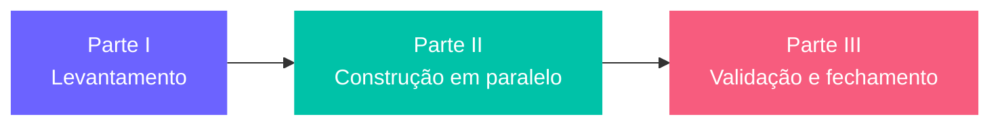

---

## 💡 Sobre o projeto

**Gente&Dados** é um projeto de **Maurício Leite de Oliveira** (Psicologia) e **Lívia Calado de Carvalho Dias** (Ciência da Computação).

A ideia é juntar as experiências de ambos, da faculdade e do trabalho, para criar uma **plataforma simples** que demonstre na prática os conhecimentos aprendidos: um lado olhando para as pessoas, o outro para os dados e o sistema.

> [!NOTE]
> O projeto simula um processo seletivo completo com uma **vaga fictícia**, dados fictícios realistas e um sistema desenvolvido em versões pequenas.

---

## 👥 Quem faz

<table>
  <tr>
    <td align="center" width="320">
      <h3>🧠 Maurício</h3>
      <b>Psicologia · RH</b> 
      Vaga, processo, conteúdos e testes
    </td>
    <td align="center" width="320">
      <h3>💻 Lívia</h3>
      <b>Ciência da Computação · TI</b> 
      Análise, banco de dados e sistema
    </td>
  </tr>
</table>

---

## 🗺️ Como o projeto funciona

O trabalho é dividido em três partes, com responsabilidades claras para cada área.

### Parte I · Levantamento

| Área | Responsabilidades |
|------|-------------------|
| 🧠 **RH** (Maurício) | Define a vaga fictícia, as etapas do processo, o scorecard[^1] e os KPIs |
| 💻 **TI** (Lívia) | Atua como analista: faz perguntas para definir o que será necessário no projeto |

### Parte II · Construção em paralelo

| Área | Responsabilidades |
|------|-------------------|
| 💻 **TI** (Lívia) | Modela o banco, desenvolve o sistema e entrega versões pequenas |
| 🧠 **RH** (Maurício) | Escreve os conteúdos (modelos de e-mail, roteiro de entrevista, descrição de vaga), cria dados fictícios realistas e testa cada versão |

### Parte III · Validação e fechamento

| Área | Responsabilidades |
|------|-------------------|
| 💻 **TI** (Lívia) | Grava o vídeo demo, publica a página, escreve o README e um case de 1 página |
| 🧠 **RH** (Maurício) | Testa como usuário e aponta ajustes |

---

## 🧰 Modelos utilizados

### Técnica MoSCoW

Usada para priorizar o que entra no projeto.

> [!IMPORTANT]
> **Must have**: o que precisa ter para o projeto funcionar.

> [!TIP]
> **Should have**: importante, mas pode esperar.

> [!NOTE]
> **Could have**: seria legal.

> [!WARNING]
> **Won't have**: fica para uma versão futura.

### Método Scrum

- Sprints de **1 semana**, com objetivos definidos a cada ciclo
- **Dailies** de no máximo **5 minutos**
- **Reelaboração dos objetivos** ao final de cada sprint

---

## 📦 Entregas previstas

- [ ] Vaga fictícia, etapas do processo, scorecard e KPIs
- [ ] Modelagem do banco de dados
- [ ] Sistema em versões pequenas
- [ ] Conteúdos de RH (e-mails, roteiro de entrevista, descrição de vaga)
- [ ] Dados fictícios realistas
- [ ] Vídeo demo
- [ ] Página publicada
- [ ] Case de 1 página

---

<b>📚 Glossário rápido</b>

 

- **KPI:** indicador-chave de desempenho
- **Scorecard:** veja a nota de rodapé abaixo
- **Sprint:** ciclo curto de trabalho com metas definidas
- **Daily:** reunião rápida de alinhamento

---

Feito com 💜 por **Maurício** e **Lívia**

[^1]: Painel ou relatório que reúne métricas e indicadores para acompanhar o desempenho de uma pessoa, equipe, projeto ou empresa em relação a metas definidas.
